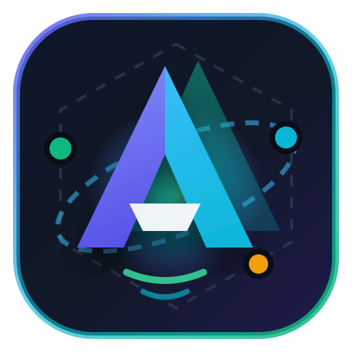

<p align="center">
  
</p>

<h1 align="center">Anti-Multi Studio</h1>

<p align="center">
  <strong>Google Antigravity 다중 계정 · 다중 인스턴스 동시 실행 & 기기 식별값(Fingerprint) · 프록시 IP 격리 플랫폼</strong><br/>
  지원 운영체제: <strong>macOS (Apple Silicon & Intel) · Windows (x64 & ARM64) · Linux (x64 & ARM64)</strong>
</p>

---

## 핵심 기능

1. **다중 인스턴스 동시 실행 (`Multi-Instance Isolation`)**
   - 프로필마다 완전히 분리된 `--user-data-dir` 및 독립 `HOME` / `USERPROFILE` / `XDG_*` 디렉터리를 시딩하여 여러 개의 Antigravity 창을 서로 다른 Google 계정으로 동시에 실행합니다.
   - `SSH_CONNECTION` / `SSH_CLIENT` 환경 변수를 주입하여 `language_server`가 OS 전역 키체인(Windows 자격 증명 관리자 / macOS Keychain / Linux Secret Service) 대신 프로필별 격리 파일(`~/.gemini/jetski-standalone-oauth-token`)만 참조하도록 강제합니다.

2. **프로필별 로컬 스텔스 게이트웨이 (`ProfileStealthGateway`)**
   - 인스턴스마다 독립 로컬 HTTP 게이트웨이(`CLOUD_CODE_URL=http://127.0.0.1:<port>`)를 구동하여 `language_server`의 모든 `v1internal:*` 요청(단방향 JSON, Gzip 압축 본문, SSE 실시간 스트리밍 포함)을 가로챕니다.
   - `User-Agent`, `Client-Metadata`, 요청 본문 `metadata.installationId` / `metadata.platform`, `Authorization: Bearer <token>` 헤더를 해당 프로필의 기기값과 토큰으로 실시간 치환합니다.
   - 텔레메트리 및 로그 수집 엔드포인트(`/log`, `:recordTrajectoryAnalytics`, `:recordClientEvent`, `:recordCodeAssistMetrics`, `:uploadPerformanceProfile`)를 게이트웨이 단에서 차단합니다.

3. **외부 프록시(SOCKS5 / HTTP CONNECT) 및 출구 IP 격리**
   - 프로필마다 개별 `socks5://` 또는 `http://` 프록시를 지정할 수 있으며, 원클릭 출구 IP / 국가 / 지연시간 테스트를 지원합니다.

4. **온보딩 / 약관 모달 자동 스킵 (`Zero-Prompt Workspace Entry`)**
   - `app_storage.json`, `storage.json`, `state.vscdb`, `antigravity_state.pbtxt`, `.gemini/config/*`를 사전 시딩하여 첫 실행 시 `Security Notice & Data Use` 및 초기 설정 마법사 없이 즉시 메인 워크스페이스로 진입합니다.

---

## 운영체제별 실행 방법 (macOS / Windows / Linux)

> **필수 요구사항**: Node.js `v22.5.0` 이상 (내장 `node:sqlite` 사용으로 네이티브 C++ 빌드 도구나 외부 패키지가 필요하지 않습니다)

### 1. Windows
```powershell
# 의존성 설치 및 빌드
pnpm install
pnpm build

# 실행 (자동으로 http://127.0.0.1:4300 웹 대시보드 오픈)
pnpm start
# 또는 start-windows.bat 더블클릭
```
- **자동 탐색 경로**: `%LOCALAPPDATA%\Programs\antigravity\Antigravity.exe`, `C:\Program Files\Antigravity\Antigravity.exe`
- **로컬 계정 가져오기**: Windows 자격 증명 관리자(`gemini:antigravity`), `~/.gemini/jetski-standalone-oauth-token`, `%APPDATA%\Antigravity\User\globalStorage\state.vscdb` 자동 지원

### 2. macOS (Apple Silicon `arm64` / Intel `x64`)
```bash
pnpm install
pnpm build

chmod +x start-mac.command
./start-mac.command
```
- **자동 탐색 경로**: `/Applications/Antigravity.app`, `~/Applications/Antigravity.app` (설정에서 `.app` 번들 경로만 입력해도 내부 `Contents/MacOS/Antigravity` 실행 바이너리를 자동으로 찾아 독립 프로세스로 스폰합니다)
- **로컬 계정 가져오기**: macOS Keychain (`security find-generic-password`), `~/.gemini/jetski-standalone-oauth-token`, `~/Library/Application Support/Antigravity/User/globalStorage/state.vscdb` 자동 지원

### 3. Linux (`x64` / `arm64`)
```bash
pnpm install
pnpm build

chmod +x start-linux.sh
./start-linux.sh
```
- **자동 탐색 경로**: `/usr/bin/antigravity`, `/opt/Antigravity/antigravity`, `~/.local/bin/antigravity`, `/snap/bin/antigravity`, Flatpak, `~/Applications/Antigravity.AppImage`
- **로컬 계정 가져오기**: FreeDesktop Secret Service (`secret-tool`), `~/.gemini/jetski-standalone-oauth-token`, `~/.config/Antigravity/User/globalStorage/state.vscdb` 자동 지원
